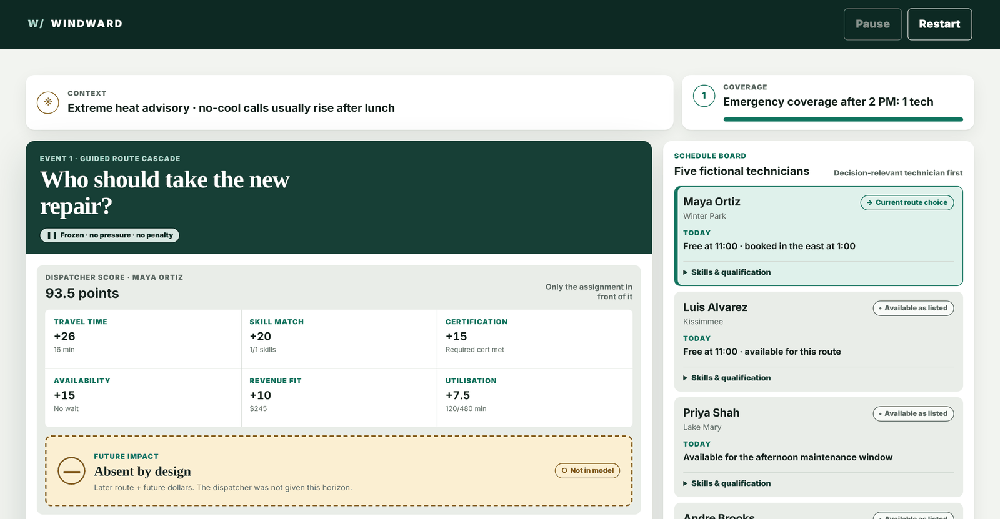
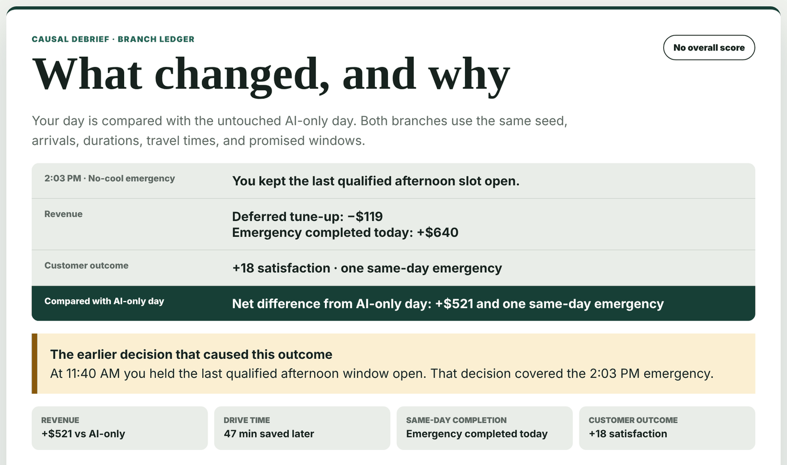

# Windward

**Supervise an AI dispatcher: see what it chose, what it passed over, and decide when to step in.**

[**▶ Play the live demo**][live-console] · runs in your browser · no sign-up · three short cases

[][live-console]

## The idea

When an AI system schedules work on its own, what is the human supervisor
actually for? Windward's answer: the human supplies horizon, policy, and risk
appetite, not just error correction.

You supervise a simulated dispatcher that assigns fictional HVAC technicians in
Central Florida. The dispatcher is deliberately short-sighted: it scores only the
job in front of it. Each decision shows its full scoring, what it never
considered, and two choices, **Keep** or **Override**. A debrief then replays
your day against the untouched AI-only day, so you can see exactly which
decision changed the outcome.



## Three cases

| Case | The decision | What it tests |
|---|---|---|
| **1 · Horizon** ([play][live-console]) | Who takes the new repair, and do you give away the last qualified afternoon slot? | Thinking past the assignment in front of the AI |
| **2 · Risk appetite** ([play][risk-console]) | Take the plan with the higher average, or the one that stays inside the business's $15,000 loss limit? | Judging a risk decision across many possible days, not one lucky outcome |
| **3 · Breadth** ([play][breadth-console]) | A technician calls in sick. Release the AI's four-visit recovery, or a plan that touches fewer schedules? | Knowing when a machine answer is good enough to release |

## How I built it

I build with a crew of AI coding agents. They write the code; I own the
decisions: what to build, what "done" means, and what ships. I wrote up the
rules I use to supervise them in [Field Notes][field-notes].

- **Spec before code.** The [design specification][design-spec] came first and
  is still the product contract. It sets the thesis, what the dispatcher must
  deliberately leave out, and a list of reasons a reviewer might close the tab,
  each with a required fix.
- **Prototype first.** A throwaway clickable [storyboard][storyboard] came
  before the real console.
- **Agents implement in parallel; gates decide what merges.** I run agents
  through [firstmate][firstmate], which gives each task its own workspace.
  Changes go through an automated AI review ([no-mistakes][no-mistakes]) before
  they become pull requests, and CI runs the type check, the behavioral test
  suite, and Markdown and link checks on every pull request.
- **Evidence, not claims.** The cases were played through keyboard-only and
  checked at phone width and with reduced motion, with screenshots kept as
  [evidence][focus-evidence].
- **Honest scope.** Every debrief ends with a panel stating what the case study
  does *not* prove.

Decisions I'd point to:

- **The dispatcher is short-sighted on purpose.** Every mistake in Case 1 has a
  single cause: a choice that is good now and bad later.
- **The interface never re-scores anything.** Every number on screen comes from
  the engine, so the demo can't drift from the logic it explains.
- **No backend, accounts, or database.** The demo is a static page, so it keeps
  working for years without upkeep.
- **The ending is a debrief, not a score.** Replaying teaches supervision
  instead of rewarding score-chasing.

## Under the hood

A dependency-free, deterministic TypeScript engine with a static browser client.
Windward does not call a model.

- `dispatch(boardState, job)` returns its winner only as part of a full,
  evidence-bearing ranking. It ranks on six factors: travel time, skill match,
  certification, availability, revenue fit, and utilisation. Certification is a
  hard constraint, and a missing one stays visible as a named disqualifier.
- `computeCoverage(boardState, requirement)` describes emergency coverage
  separately and never feeds back into ranking. A job's promised time window is
  replay evidence, not a ranking factor.
- Seeded replay runs the player's branch and an AI-only baseline from identical
  events, and fails closed if the two drift apart.
- Case 2 uses `rankPlans(input)`, an expected-value-only evaluator, plus an
  exact, versioned replay over 100 weighted worlds in integer cents. The loss
  limit is policy evidence applied after ranking.
- Case 3 dispatches four recovered visits one at a time, keeping each ranking,
  state change, and branch outcome as evidence.

The client in `index.html` imports the compiled engine and console layer from
`dist/`.

## Run it locally

```sh
npm ci
npm run check   # type check, build, and tests
python3 -m http.server 4173
```

Then open `http://localhost:4173/`.

---

Independent portfolio project inspired by a public "AI Operations Strategist"
job posting. Not affiliated with, endorsed by, or built for any company. Every
company, technician, customer, and data point in the simulation is fictional.
Windward uses a deliberately myopic simulated dispatcher; it does not show how
any real vendor's model behaves.

[live-console]: https://connectwithclayton.github.io/windward/
[risk-console]: https://connectwithclayton.github.io/windward/#risk-appetite
[breadth-console]: https://connectwithclayton.github.io/windward/#breadth
[design-spec]: docs/design/2026-08-18-windward-design.md
[storyboard]: docs/design/storyboard/index.html
[focus-evidence]: docs/evidence/2026-08-20-case3-focus-walk/README.md
[field-notes]: https://fieldnotes.clayj.app
[firstmate]: https://github.com/kunchenguid/firstmate
[no-mistakes]: https://github.com/kunchenguid/no-mistakes
